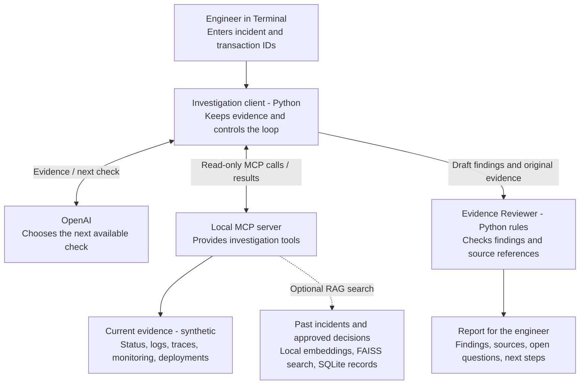

# Incident Investigation Agent

## Project

An OpenAI-assisted Python application that helps engineers investigate delayed or failed
payment transactions from Terminal. It gathers current evidence, optionally searches similar
past incidents, and produces a report with supported findings, sources, and open questions.

This capstone uses **synthetic data** and has no production connections. The examples below
use **OpenAI** to choose the next investigation check.

## Problem

Investigating a stuck transaction means connecting information from transaction status,
application logs, distributed traces, monitoring, and recent deployments. Past incidents may
suggest where to look, but a similar symptom does not prove the same root cause.

This project brings those checks into one guided workflow. It collects evidence step by step,
chooses a useful next check, and separates what the records support from what still needs an
engineer's investigation. The engineer confirms the root cause and performs any recovery.

## Architecture

The diagram shows the OpenAI investigation flow. **MCP (Model Context Protocol)** connects
the client to read-only tools. **RAG (retrieval-augmented generation)** adds relevant past
incidents as context when history search is enabled.



1. **Start an investigation.** The engineer supplies incident and transaction IDs. The Python
   client starts the local MCP server automatically and reads the transaction and logs.
2. **Choose and run checks.** With RAG enabled, the client also searches past incidents.
   OpenAI receives the observed evidence and chooses among available checks. Python validates
   the choice, calls the tool, and adds its result to the investigation memory. This repeats
   until the request is answered or a stopping rule is reached.
3. **Review the findings.** An independent Evidence Reviewer checks the draft against the
   original records. It uses Python rules, allows one local correction and recheck, and
   escalates unresolved evidence issues to an engineer.
4. **Return the report.** The engineer sees what is supported, what remains uncertain, and
   which checks could help next. Root-cause confirmation and recovery remain human decisions.

This step-by-step evidence, action, and observation cycle is the **ReAct loop**. Python runs
fixed setup steps and any sole remaining check without a model request; OpenAI chooses when
multiple checks remain. The client owns tool execution, validation, and stopping rules.

Each investigation allows at most **8 tool attempts**, including retrieval and retries.
Current logs and a separate current trace must support a settlement-call failure point.
Historical matches provide leads; they cannot confirm the current root cause.

Saving knowledge is a separate, human-approved command. It stores complete decisions and
actions in SQLite and updates the FAISS search index for future investigations. The agent
has no MCP tool for saving knowledge.

See the [detailed architecture](docs/architecture.md) and
[reasoning design choice](docs/architecture.md#why-we-use-react-instead-of-tot).

## Setup steps

### 1. Install the project

Use **Python 3.12** for the commands below. Open Terminal in the project folder containing
`pyproject.toml`:

```bash
python3.12 -m venv .venv
.venv/bin/python -m pip install -e '.[dev]'
```

These commands create a local Python environment and install the application and development
tools. Environment activation is not required because the commands use `.venv/bin/` directly.
An alternative [locked setup with uv](docs/architecture.md#locked-installation-with-uv)
is also available.

### 2. Prepare historical search

For investigations with RAG, build the local search index:

```bash
.venv/bin/incident-index
```

The first build downloads a CPU embedding model and indexes the five synthetic historical
cases plus any approved saved decisions. No GPU or separate database server is required.
You can skip this step when running without RAG.

### 3. Provide an OpenAI API key

Have an OpenAI API key ready. The usage commands below include `--ask-key`, which prompts
for the key without displaying or saving it. OpenAI requests use your paid API account.
If `OPENAI_API_KEY` is already exported in your Terminal, omit `--ask-key`.

For optional settings, see [.env.example](.env.example); export them in Terminal because
the app does not load `.env` files automatically.

The environment, downloaded model, index, and saved decisions are excluded from Git.
Back up `data/knowledge/` to preserve approved decisions. The search index in `data/rag/`
can be rebuilt with `incident-index`.

## Usage

### Investigate with OpenAI

Run the included example with current evidence only:

```bash
.venv/bin/incident-client --incident-id INC-10234 --transaction-id TX784521 \
  --use-rag --planner openai --ask-key
```

### Read the results

The terminal shows investigation progress followed by a summary of the supported failure
point, possible causes, missing evidence, next steps, and Evidence Reviewer outcome.
Passing the evidence review does not mean the root cause has been confirmed.

Add these options to an investigation command as needed:

| Option | Purpose |
| --- | --- |
| `--verbose` | Show full action reasons, evidence, and source references. |
| `--json` | Print the complete structured report. |
| `--scope status` | Read transaction status only, without a full investigation. |

Reports print to Terminal without creating report files. If an API step pauses, see
[troubleshooting](docs/architecture.md#if-the-api-planner-pauses).

### Compare with and without RAG

Run the default example twice using OpenAI, once in each mode:

```bash
.venv/bin/incident-compare --planner openai --ask-key
```

The comparison shows the next checks, tool counts, and whether a changed check cited retrieved
history. OpenAI choices may vary; RAG does not guarantee a different order or fewer calls.

### Save an engineer's decision

After reviewing the evidence, an engineer can record a decision, the action actually taken,
and its outcome:

```bash
.venv/bin/incident-knowledge save
```

The command previews the record and requires typing `SAVE` before storing it. The root cause
can remain unknown and the outcome can be pending. See the
[human-decision guide](docs/human-decisions.md) for fields, storage, and retrieval details.

### Run tests and repeatable evaluations

These checks do not require an OpenAI API key. The paired evaluation explicitly uses the
Python demo planner for repeatable results; it does not measure OpenAI decisions.

```bash
# Tests without an API key or model downloads.
.venv/bin/python -m pytest -q
.venv/bin/ruff check .
.venv/bin/ruff format --check .

# Evaluate eight synthetic cases with and without RAG using Python rules.
.venv/bin/incident-compare --evaluate --planner demo

# Evaluate Evidence Reviewer decisions on the shared cases.
.venv/bin/python -m incident_client.evaluation

# Include real embedding and retrieval checks after preparing the index.
RUN_RAG_INTEGRATION=1 .venv/bin/python -m pytest -q
```

More detail: [architecture and reasoning choice](docs/architecture.md),
[RAG design](docs/rag-module.md), [shared evaluation results](docs/evaluation.md),
and [saving human decisions](docs/human-decisions.md).
