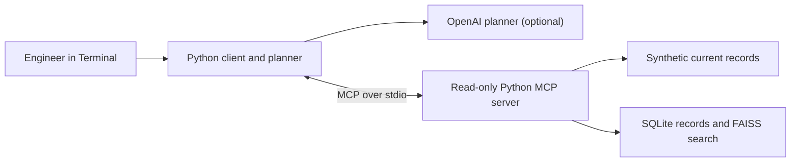

# Incident Investigation Agent

A Python MCP client and server for investigating synthetic transaction incidents from Terminal.

## What it does

- Reads transaction status, logs, traces, monitoring, and deployment history.
- Uses RAG to find similar past incidents and approved human decisions.
- Offers optional Tree of Thought (ToT) planning to compare possible causes.
- Shows investigation progress, supported findings, and open questions.
- Requires an engineer to confirm the root cause, perform recovery, and approve knowledge saves.

Each cycle allows at most **8 tool attempts**, including retrieval and retries. Current logs
and a separate current trace must support the settlement failure point. Past cases are leads.

## High-level architecture



The client starts and stops the MCP server automatically. Python rules drive the demo;
OpenAI planning is optional. A separate human save command writes approved records to
SQLite and updates the FAISS index.

## Running locally

Use **Python 3.12**. From the project folder containing `pyproject.toml`:

```bash
python3.12 -m venv .venv
.venv/bin/python -m pip install -e '.[dev]'
.venv/bin/incident-index
```

The index command downloads the local embedding model once and builds the vector index.
No GPU or environment activation is needed. A new clone does not include `.venv`, cached
models, index files, or saved decisions. Back up `data/knowledge/` to preserve your decisions.

For optional settings, see [.env.example](.env.example); export them in Terminal because
the app does not load `.env` files automatically. An alternative
[locked setup with uv](docs/architecture.md#locked-installation-with-uv) is also available.

## Terminal commands

```bash
# Investigate without history or an API key.
.venv/bin/incident-client --no-use-rag --planner demo

# Compare without/with RAG using real retrieval and Python rules.
.venv/bin/incident-compare --planner demo

# Investigate without/with RAG using OpenAI and a hidden key prompt.
.venv/bin/incident-client --no-use-rag --planner openai --ask-key
.venv/bin/incident-client --use-rag --planner openai --ask-key

# Add bounded ToT planning to a RAG demo.
.venv/bin/incident-client --use-rag --reasoning tot --planner demo

# Evaluate six synthetic cases with and without RAG; no API key.
.venv/bin/incident-compare --evaluate

# Review and explicitly approve saving a human decision and action.
.venv/bin/incident-knowledge save
```

The default example is **INC-10234 / TX784521**. OpenAI commands use your paid API account;
the key is not saved. Investigations use `linear` reasoning unless `--reasoning tot` is selected.

For investigation and comparison commands, add `--verbose` for full reasons and sources,
or `--json` for structured output. They print to Terminal without creating report files.
If an API step pauses, see [troubleshooting](docs/architecture.md#if-the-api-planner-pauses).

## Running tests

```bash
# Tests without an API key or model downloads.
.venv/bin/python -m pytest -q
.venv/bin/ruff check .
.venv/bin/ruff format --check .

# Include real embedding and retrieval checks after preparing the index.
RUN_RAG_INTEGRATION=1 .venv/bin/python -m pytest -q
```

More detail: [architecture and ToT](docs/architecture.md),
[RAG design and evaluation](docs/rag-module.md),
and [saving human decisions](docs/human-decisions.md).
