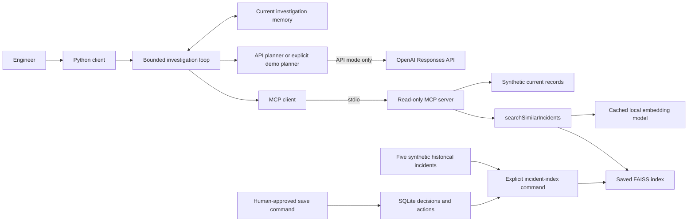

# Architecture



## Investigation loop and memory

The client owns decisions and hard limits. The model receives only observations already returned
by tools. It chooses among available checks and gives a short action reason with references.
Python validates the selected tool and references before sending a request through MCP.

Transaction lookup, log lookup, and (in RAG mode) history search are common setup steps. The API
model chooses the order of trace, monitoring, and deployment checks when more than one remains.
A final sole remaining check needs no model call. This is a constrained agent, and the comparison
uses the same model instructions in both runs. Final findings come from checked current facts.

Short-term memory keeps the current observations, tried tools, references, and remaining budget.
Long-term memory holds approved historical decisions and actions. Current evidence and past
context stay separate: retrieval scores are not evidence and cannot reset the no-new-evidence count.

Each cycle allows at most eight tool attempts, including RAG retrieval, failed calls, and retries.
A failed tool gets at most two retries within that same budget; eight calls never becomes ten.
Two consecutive steps with no new meaningful evidence pause the cycle sooner. A successful tool
with no useful result is different from a failed tool, and missing evidence is not proof.
The agent can finish early when it has answered the request. Otherwise it shows open explanations,
what was checked and not supported, and asks the engineer whether to continue.

## Choosing the next check

`prioritize_checks()` ranks unused checks using observations already returned. `assess_causes()`
compares shared service failures, transaction-specific failures, and recent changes. Both planners
receive these priorities; the API planner also sees the cited possible causes and the raw records.
The demo planner follows the first ranked check. High, medium, and low describe how useful a
check is, not the chance that a possible cause is correct.

- Settlement HTTP 503 logs make the current trace a useful next check.
- Once logs and the trace show failed settlement calls, service health and nearby transactions
  help separate a shared service problem from a problem affecting this transaction alone.
- A local application error makes recent deployments useful to check first.
- A matching past case can move a useful check earlier, such as monitoring. Stronger current
  evidence takes priority over the old case.

A completed monitoring or deployment check is reused as evidence rather than called again
automatically. Failed tools still follow the retry rules. An empty result or unfinished deployment
check does not prove that no related change happened. A completed check with no related change
only makes that explanation less supported within the check's coverage.

### Why we use ReAct instead of ToT

The chosen design uses CoT-style, step-by-step reasoning within a ReAct tool loop:
read evidence, choose one useful check, observe the result, then update or stop. It keeps
several possible causes open without building a tree. The API planner chooses among allowed
checks; the demo uses repeatable Python rules. Both use the same tool and evidence checks.

Breadth-first search (BFS) is an option for a Tree of Thoughts (ToT) design. It explores
candidate paths level by level before moving deeper. With only three possible causes,
BFS would be reasonable to consider. We did not implement or test BFS, so we cannot claim
that it would improve or worsen this agent's results.

In the earlier ToT trial on synthetic INC-10234 / TX784521, RAG was enabled in both runs.
The ordinary loop and the ToT trial each used six tool calls in the same order:
transaction, logs, similar incidents, monitoring, trace, and deployments. Both supported the
settlement-service call as the failure point; neither confirmed the underlying root cause.
This local demo used Python planning rules and real MCP tools. It did not measure paid model
cost, model variability, or production accuracy.

For this use case, the main gap is missing current evidence. Generating more paths cannot
explain a settlement HTTP 503 without the service data needed to test its cause. A ToT design
using BFS would still need to store candidate paths, decide which checks to expand, and
manage search limits. More planning could add cost and delay without supplying the missing
evidence. These are design concerns, not measured BFS results. The current loop can track
all three possible causes and choose a useful check without a tree.

The ordinary loop still adapts: a matching past incident can suggest monitoring first,
while a current local error makes recent changes more useful to check. RAG can change that
choice without ToT. Current logs and a separate trace must support a settlement failure point.
The engineer still confirms root cause, performs any fix, and explicitly approves a save.

ToT may help a future workflow with many competing paths or conflicting evidence. We would
compare a BFS-based ToT design with the ordinary loop on those cases before adopting it.
The comparison would check finding quality, tool calls, and unsupported conclusions.
For the current small workflow, the simpler loop is easier to test and explain. For this use case, the ReAct loop provides the needed step-by-step reasoning and is easier to test and explain.

### Compare transactions in the same time window

Monitoring includes a validated `monitoring_window` with service health and sampled transactions:

| Sample detail | Synthetic example |
| --- | --- |
| Service | Settlement |
| Time window | January 15, 2026, 09:55–10:10 UTC |
| Reported error start | 10:00 UTC |
| Transactions sampled | 6 |
| Successful transactions | 2, at 09:56 and 09:58 UTC, before the error start |
| Failed transactions | 4 HTTP 503s between 10:00 and 10:02 UTC, including TX784521 |

At least two other sampled HTTP 502/503 failures within five minutes of this transaction raise
the shared-service check priority. This makes a transaction-only explanation less supported.
Nearby successful transactions with only the target failing raise the transaction-specific check
priority; unsampled failures can still exist. These are small teaching rules, not probabilities.
Six sampled transactions do not prove a full outage. Successes before the error start do not prove
that the service recovered.

The data checks reject missing time zones, impossible time ranges, incorrect counts, duplicate
sampled transactions, inconsistent HTTP results, and a window extending past the monitoring
record's timestamp. A missing optional window is different from an invalid window.

## Findings and engineer control

The final result lists evidence for and against each possible cause, missing evidence, and the
next useful check. The terminal defaults to a short summary. `--verbose` shows full evidence and
references; `--json` displays all structured result fields. No report files are created.
A past connection-pool case can add that lead, but the current tools have no pool metrics, so
the agent asks the engineer for them.

Only current settlement logs plus a current failed settlement trace establish the supported
settlement-call failure point. If two separate current sources do not support it, it remains a
possible failure point. A historical decision is a lead, not proof of this incident's cause.
Only an engineer confirms root cause and separately approves saving knowledge. Fixes stay manual.
The added summaries cannot change the eight-call limit or these evidence and approval rules.

## Read-only tools and historical search

The server owns data access. Current tools read synthetic fixtures. `searchSimilarIncidents`
uses a query built from observed transaction and log summaries. One compact historical incident
is one search document. Only its title, symptoms, and service are embedded; the stored past cause
and suggested check are returned after retrieval. An approved saved incident can join the index.
Its ID is excluded when that same incident is investigated, so it cannot be its own past evidence.

The index build is separate from an investigation. The MCP server exposes no knowledge-write tool.
A separate human-operated `incident-knowledge` command saves approved records to SQLite and
rebuilds the index. SQLite stores complete decisions and actions; FAISS stores vectors.
Index metadata records the full record-set hash, model, dimension, metric, and index checksum.
A changed or damaged index causes a tool error, distinct from a successful search with no useful
match. Load only locally generated index files: checksums detect accidental damage, not a
malicious index with a forged manifest.

## API boundary

The API key stays in the client. The stdio server receives the selected local index/database paths
and the MCP library's standard process environment. The key is not a tool argument or result field.
API attempts are counted separately from the maximum eight investigation tool attempts. API SDK
retries are disabled; an API failure pauses the run with its current audit trail.
`api_errors.py` turns SDK error types, HTTP status numbers, and known error codes into fixed
messages for the `AI issue` line. Keys, raw provider bodies, and exception text are excluded.
This identifies an error category without guessing that a past incident caused the API failure.

## Local setup and troubleshooting

### Locked installation with uv

As an alternative to the Python/pip setup in the README, an existing
[uv installation](https://docs.astral.sh/uv/getting-started/installation/) can create `.venv`
and install the versions in `uv.lock`:

```bash
uv sync --locked --extra dev
uv run incident-index
uv run incident-client --use-rag --planner demo
```

The pip setup uses the version ranges in `pyproject.toml`; uv uses the lock file.

### Settings and local data

[.env.example](../.env.example) lists optional environment settings. Export them in Terminal;
the app does not load `.env` files automatically. `OPENAI_MODEL` can select a model supporting
the same structured-output options. `INCIDENT_RAG_DIR` changes the model/index directory;
build and run must use the same path. `INCIDENT_KNOWLEDGE_DB` selects the approved-decision database.

Tool timeouts default to 10 seconds and API timeouts to 30 seconds. `MAX_API_INPUT_BYTES`
defaults to 131072 and `MAX_API_CALLS` to 8. API requests are separate from investigation tool
attempts. These guards do not impose a dollar spending cap; API use is billed to the key's account.

The Python environment, model cache, index, and SQLite data are excluded from Git. A new clone
starts with the five historical seed cases. Restore `data/knowledge/` separately to retain approved
decisions, then rebuild with `incident-index`. Use `incident-index --offline` when the model is
already cached. Index rebuilds retain old generations; they are not removed automatically.

### If the API planner pauses

Transaction, log, and retrieval calls can finish before the first model request. An API error
pauses with the evidence already collected. Eight calls is a maximum, not a target, and the
client does not silently switch to demo rules. The `AI issue` line gives a safe error category.

| Message | What to check |
| --- | --- |
| HTTP 401 | API key and selected API project |
| HTTP 403 | Project permissions and model access |
| HTTP 404 | Model name, access, and any custom API base URL |
| HTTP 429 credit or quota limit | Available API credit and billing |
| HTTP 429 project or organization spend limit | The spending limit for the selected project or organization |
| HTTP 429 organization usage limit | The account's approved API usage limit |
| HTTP 429 rate limit | Wait before starting another run |
| HTTP 400 or 422 | Model, output schema, and request settings |
| Timeout or connection problem | Internet connection, VPN, or proxy settings |
| HTTP 5xx | API service availability; try another run later |
| Invalid AI decision | Output format and client version |

For a limit error, check [API billing](https://platform.openai.com/settings/organization/billing/overview)
and [API limits](https://platform.openai.com/settings/organization/limits) for the same project
and organization as the key. Adding credit helps only when credit is the problem. The synthetic
settlement HTTP 503 is separate from an OpenAI API failure. Keys and raw provider responses
are never printed by the app's error reporting.

## Code map

| Purpose | Location |
| --- | --- |
| API model and checked generated actions | `client/src/incident_client/llm.py` |
| Allowed tools and deterministic demo | `client/src/incident_client/policy.py` |
| Possible causes, evidence, and missing checks | `client/src/incident_client/hypotheses.py` |
| Shared cause result display | `client/src/incident_client/reporting.py` |
| Timed monitoring contract | `shared/src/incident_common/monitoring_models.py` |
| Stop rules and final evidence checks | `client/src/incident_client/investigation.py` |
| MCP transport and result validation | `client/src/incident_client/mcp_client.py` |
| Embeddings and vector index | `server/src/incident_server/rag.py` |
| Five historical incidents | `server/src/incident_server/fixtures/historical_incidents.json` |
| Terminal comparison | `client/src/incident_client/compare.py` |

## Durable human knowledge

See [the save guide](human-decisions.md). `knowledge.py` owns the SQLite transactions;
`knowledge_cli.py` is the human entry point; `knowledge_models.py` validates the record.
Search reads approved SQLite records along with seed cases, checks the full record-set hash, and
returns decision/action/outcome fields only as past context. The no-write investigation boundary,
eight-call limit, and current-evidence requirements stay outside the model.
