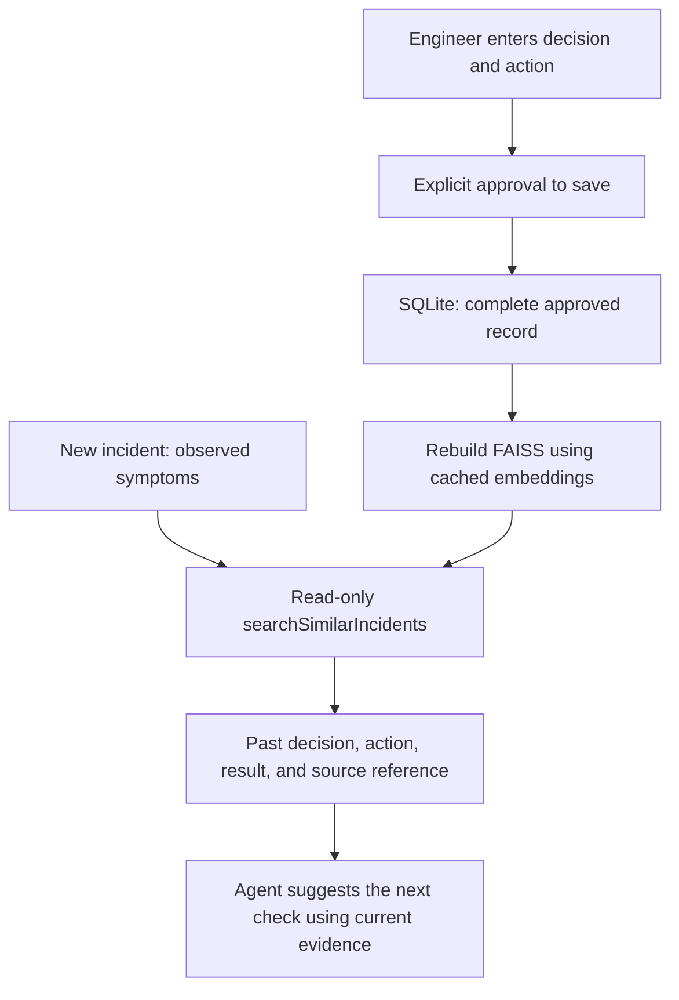

# Save a human decision and the action taken

The app now has a local SQLite database for reviewed incident knowledge. It stores the complete
human decision and action, rather than only a vector. SQLite is included with Python, so this
feature needs no extra database server and no API key.

## Save your first record

Open Terminal in the project folder:

```bash
.venv/bin/incident-knowledge save
```

The command asks for the incident ID, title, symptoms, affected service, human decision, action
actually taken, outcome, and engineer name. You can leave the confirmed root cause blank if it is
still unknown. The accepted outcome values are `resolved`, `improved`, `no_change`, `pending`, and
`unknown`. If no recovery action happened, describe the action accurately, for example “No action
yet; waiting for service recovery.”

The command displays the record for review. Type `SAVE` to approve storing it, or anything else to
cancel. This is an explicit human save step. The investigation agent cannot call it as an MCP tool.
The engineer name is entered by the local operator; multi-user login and identity checks are not
part of this capstone version.

After an approved save, you should see:

```text
saved: INC-10234
Database: .../data/knowledge/incidents.sqlite3
Human decision: ...
Action taken: ...
Outcome: ...
Search index updated: yes
```

## What is stored

The database is created on the first approved save:

```text
data/knowledge/incidents.sqlite3
    └── human_decisions table
```

| Column | Meaning |
| --- | --- |
| incident_id, title, symptoms, service | Identifies the incident and the pattern to search |
| human_decision | What the engineer decided and why |
| action_taken | What actually happened, rather than a suggested action |
| outcome | Resolved, improved, no change, pending, or unknown |
| approved_by, saved_at | Operator-entered engineer name and system-generated UTC save time |
| confirmed_root_cause | Optional engineer-confirmed cause; can remain empty |
| evidence_references | Synthetic source references supporting the record |
| useful_check, check_reason | A suggested read-only check for a future similar incident |
| occurred_at, synthetic, record_source | Optional incident time, synthetic-data marker, and record type |

All learning records remain explicitly synthetic. Existing five synthetic seed IDs cannot be
replaced. Saving an identical record twice returns `already_saved`. A different record with the
same incident ID is rejected and leaves the original record intact; revisions are a later feature.

## Read saved records

```bash
.venv/bin/incident-knowledge list
.venv/bin/incident-knowledge show --incident-id INC-10234
```

These commands only read the database. Listing before the first save does not create one.

## Save from a JSON file

A draft for the current synthetic incident is available at
`docs/examples/human-decision-template.json`. Fill the empty `human_decision`, `action_taken`, and
`approved_by` fields and set the outcome to what actually happened. Blank required fields are
rejected. Review the complete file, then run:

```bash
.venv/bin/incident-knowledge save --file docs/examples/human-decision-template.json --approve-save
```

`--approve-save` is your explicit approval of that file. Without the flag, file-based saves are
rejected. The example at `docs/examples/human-decision-example.json` contains an invented decision
and invented action for demonstration; it is not your decision and has not been saved to your
project database automatically.

## How a future incident finds the record



The index includes the five seed cases plus saved approved records. The title, symptoms, and
service are embedded; the complete decision, action, and outcome are returned after a match.
The current incident ID is passed through MCP and excluded from its own history search, so saving
INC-10234 does not let the still-open INC-10234 use itself as supporting history. A future incident
with a different ID can retrieve it.

A stored cause never confirms the cause of a new incident. A stored action is history, not
permission to run it again. Recovery remains manual. Saving a record can have a pending result or
unknown cause; approval of the save does not imply resolution or cause confirmation. The original
investigation report describes that automated run; the separate human save does not rewrite it.

## If updating the index fails

The database transaction is committed first. An index problem cannot discard the saved decision.
The command then reports `Search index updated: no` and exits with code 2. Run:

```bash
.venv/bin/incident-index --offline
```

This retries using the cached local model. If no model was prepared yet, run `incident-index`
without `--offline` once to download it. While the database and index differ, searches reject the
old index rather than return outdated or incorrectly mapped records.

## Storage and verification

The database is durable data; back up `data/knowledge/`. The FAISS files in `data/rag/` can be rebuilt
from the seed JSON and database. Rebuilding the index never deletes approved records.
`INCIDENT_KNOWLEDGE_DB` can select another database path. `INCIDENT_RAG_DIR` selects the index/model
location. Use the same settings for saving and investigation; both paths are passed to the MCP
server, while an API key stays in the client.

Tests use private temporary databases. They cover persistence, approval, blank fields, duplicate
saves, conflicting records, database corruption, full decision/action retrieval, current-incident
exclusion, stale index detection, and saved data surviving an index failure. A separate real-model
smoke test saved and retrieved an invented example through actual MCP calls; it did not add a
record to the project database or contact an API model.

Sources: [Python SQLite documentation](https://docs.python.org/3.12/library/sqlite3.html),
[SQLite atomic transactions](https://www.sqlite.org/atomiccommit.html).
